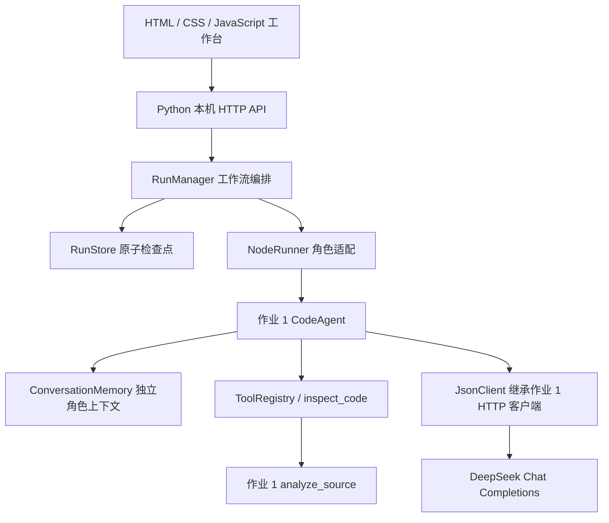
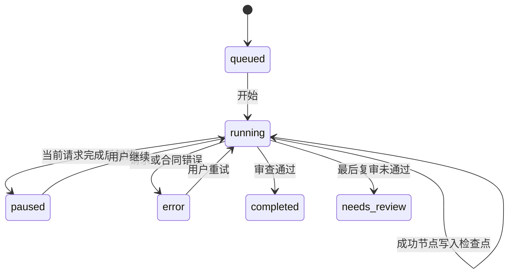

# CodeFlow 架构设计

## 目标

在作业 1 的单 Agent 框架上，增加可观察、可恢复的三角色软件工程工作流。角色负责不同决策，工作流负责依赖、共享状态、条件分支和检查点；将原工具层与新编排层分开，便于扩展。

## 分层架构

后端使用 Python 标准库，没有新建数据库、LangChain 或第三方调度系统。界面沿用 LearnFlow 的视觉语言，但运行时保留作业 1 的 Python 框架；无需安装原 LearnFlow 的 Node.js 依赖。

## 三角色合同

| 角色 | 输入 | 输出 |
| --- | --- | --- |
| 需求规划师 | 任务、语言、已有代码 | 摘要、验收标准、步骤、风险 |
| 编码工程师 | 用户输入、规划；修复时增加旧实现和审查反馈 | 实现文件、测试文件、说明、本地验证命令 |
| 代码审查师 | 用户输入、规划、实现、真实静态检查；复审时增加原审查反馈 | 通过状态、分数、问题位置、修复建议、验收清单 |

三个角色使用相同的 DeepSeek 模型，但每个角色有不同系统提示词、独立的 `CodeAgent` 与 `ConversationMemory`。它们通过显式 JSON 上下文传递信息，不共享不可见的内部思维过程。工具调用属于节点内部循环，工作流节点间则严格顺序执行。

最终模型输出必须通过 `contracts.py` 校验。产物路径限制为对应语言的 `solution`、`test_solution` 和可选 `README.md`，拒绝重复文件、路径穿越或缺少测试文件。通过结论要求至少 80 分、无高等级问题、无失败验收项。真实 Python 语法检查失败会覆盖模型错误的通过结论。

## 有限状态机

`planner → coder → reviewer` 为正常路径。初审通过结束；未通过才进入 `repair → recheck`，分别由原编码角色和原审查角色执行。复审仍未通过则进入 `needs_review`，不会再自动循环。

共享状态保存需求、成功记录、阶段、日志和错误。每个成功记录带有角色输出、模型名、请求数、token 使用和工具事件。下一节点根据已存在记录推导，不依赖前端猜测或手动指定阶段。

## 持久化、并发与恢复

`RunStore` 使用锁保护内存副本，先写临时文件再原子替换 JSON，避免半份检查点。`RunManager` 在后台线程运行模型请求，前端轮询状态，不会因刷新网页丢失与服务端任务的关联。

同一时刻只执行一项工作流。暂停使用线程事件：不强行中断 urllib 已发送的上游请求，而是在当前结果保存后停止。重试复用成功前缀；重启将此前运行中记录转成暂停。导入重新校验合同和依赖，生成新 ID，不直接执行。

历史界面展示最近 50 条；本地目录里的记录不会自动云同步或清理。JSON 是完整可迁移的成功检查点，日志只保留最新 200 条。文件系统突然失效、进程被强制结束时，最后尚未保存的调用无法保证恢复。

## 真实验证与模型评价

静态检查由原 `analyze_source` 执行；文本差异由 `difflib.unified_diff` 计算，均不是模型猜测。模型质量评分和验收判断单独标注。

生成的测试文件不在服务端自动运行，工作流也不执行模型返回的 shell 命令。用户下载、检查后在自己的可信环境中执行。Python 以外语言未接入编译器，因此不能把通用文本规则检查描述为编译或类型检查通过。

## API

| 接口 | 说明 |
| --- | --- |
| `GET /api/status` | 应用标识、是否配置、模型名、当前运行 ID |
| `GET /api/runs` | 最近 50 条摘要 |
| `POST /api/runs` | 校验输入，创建并执行任务 |
| `GET /api/runs/:id` | 状态、成功结果、真实静态检查和差异 |
| `POST /api/runs/:id/pause` | 请求在当前调用后暂停 |
| `POST /api/runs/:id/resume` | 恢复缺失节点 |
| `POST /api/runs/import` | 导入成功检查点，不自动请求模型 |
| `GET /api/runs/:id/export.json` | JSON 运行记录 |
| `GET /api/runs/:id/report.md` | Markdown 报告 |
| `GET /api/runs/:id/bundle.zip` | 实现、测试和交付报告 |

## 运行边界

新服务只绑定回环地址，校验 Host 与跨站 Origin，限制请求体，静态文件采用固定白名单。密钥只由配置层读取，接口不返回密钥或掩码片段；上游错误在写入日志前脱敏。默认单节点只尝试一次模型请求，显式恢复才会额外调用。

当前没有多用户身份、云端数据库、自动 Git 提交或任意仓库修改功能。若未来加入文件写入或执行，需要单独设计权限、资源隔离、补丁审批和审计，不能直接把旧框架的全部危险工具注册给工作流节点。

## 扩展节点

增加节点时依次完成：定义合同和必要输入；提供角色提示词；在 `next_step` 中明确依赖和终止条件；接入前端展示；补充失败、恢复与非法输出测试。例如增加测试执行 Agent 时，必须先设计实际执行环境与结果合同，并将真实测试证据回传给审查节点。
