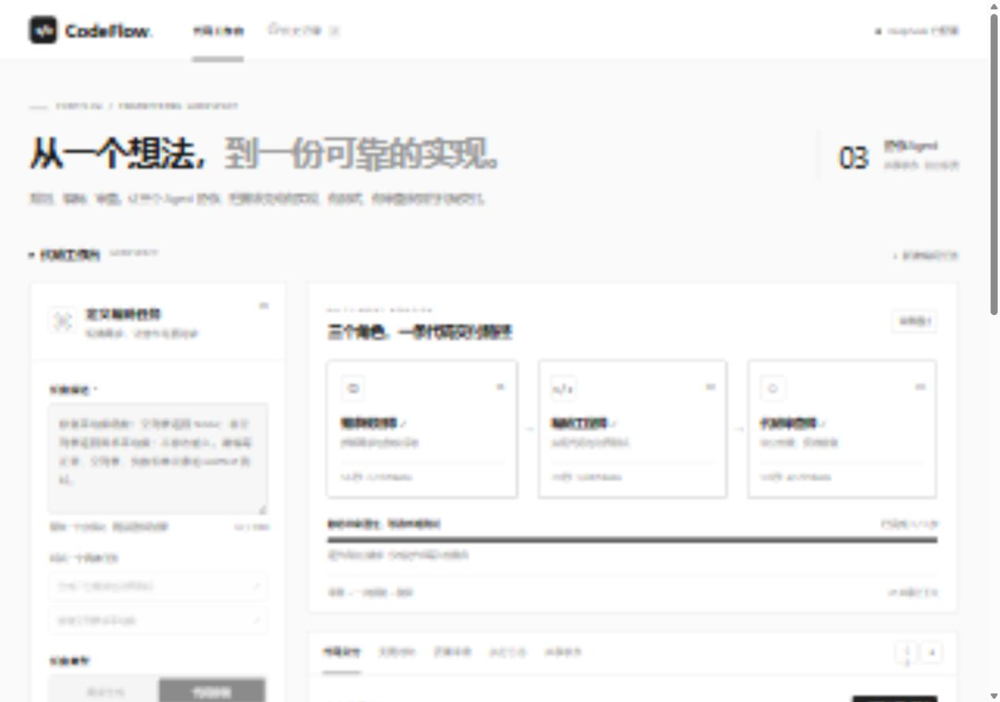
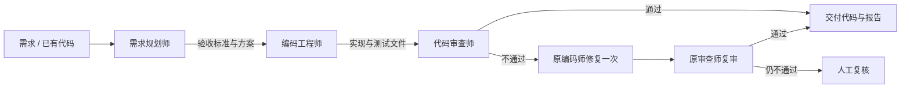

# CodeFlow · 三 Agent 代码工作流

[](https://github.com/wondermagi1/workflow/actions/workflows/ci.yml)

**从一个想法，到一份可审查的实现。**

CodeFlow 是一个基于 Python 的多 Agent 编码工作台，将编码任务交给 **需求规划师 → 编码工程师 → 代码审查师** 协作处理。每个角色独立调用模型，通过 JSON 共享需求、验收标准、代码和审查反馈；首轮未通过时，编码师修复一次，再由审查师复审。

界面采用黑、白、灰视觉：大标题、细线边框、黑色主按钮、独立的角色卡片与清晰的代码阅读区域。



[查看移动端截图](docs/images/mobile.jpg) · [架构设计](Design.md) · [使用指南](docs/workflow.md) · [测试与验证](docs/validation.md)

## 核心功能

| 功能 | 行为 |
| --- | --- |
| 需求生成 / 代码修复 | 描述需求，或粘贴 / 导入一个现有代码文件 |
| 三角色协作 | 独立提示词、独立模型请求、明确的输入输出合同 |
| 条件分支与有限循环 | 3 个主节点；审查不通过时增加一次修复与一次复审，最多 5 个工作流节点 |
| 真实静态检查 | 使用 Python AST 与通用文本规则，将检查结果交给审查 Agent |
| 代码交付 | 浏览实现和测试文件、复制、下载包含代码与报告的 ZIP |
| 变更对比 | 基于原始输入和最新实现计算真实 unified diff |
| 质量审查 | 展示问题位置、严重度、建议、验收清单和模型评分 |
| 检查点恢复 | 每个成功节点落盘；暂停后续节点、失败重试、服务重启恢复 |
| 记录与导出 | 搜索最近 50 条本机记录，导出 Markdown / JSON，导入 JSON 恢复 |
| 离线固定演示 | 无需密钥演示完整五步修复闭环，明确标注没有调用真实模型 |

支持 Python、JavaScript、TypeScript 的单模块任务。Python 提供 AST 语法和静态规则检查；JavaScript / TypeScript 当前只做通用文本规则检查。模型生成测试文件，**工作流不会自动执行生成的代码或测试**。

## 快速开始

需要 **Python 3.10 或更高版本**。项目只用 Python 标准库，无需安装第三方依赖，也不要求 Node.js。

获取项目并运行：

```bash
git clone https://github.com/wondermagi1/workflow.git
cd workflow
python workflow.py --open
```

浏览器打开 [http://127.0.0.1:8010](http://127.0.0.1:8010)。Windows 也可双击 **`启动代码工作流.bat`**。保持启动终端运行，按 `Ctrl+C` 停止服务。端口占用时可指定：

```bash
python workflow.py --port 8011 --open
```

### DeepSeek 配置

复制 `.env.example` 为 `.env`，填入自己的服务端密钥：

```dotenv
CODE_AGENT_API_KEY=your_deepseek_api_key
CODE_AGENT_BASE_URL=https://api.deepseek.com
CODE_AGENT_MODEL=deepseek-flash
CODE_AGENT_PROVIDER=openai
```

这里 `openai` 表示 OpenAI 兼容协议客户端，实际请求发往配置的 DeepSeek 地址。环境变量优先于 `.env`，修改后重启服务。密钥不会返回给浏览器，`.env`、运行记录与本机日志均由 Git 忽略。

后端使用 JSON 输出，显式关闭 DeepSeek 思考模式，单次请求超时 120 秒；不进行隐藏的自动计费重试，失败后由用户显式继续。一个工作流节点可在 Agent 循环内调用静态检查工具，因此其模型请求数可能大于 1，页面会记录实际请求数和 token 用量。

官方协议见 [DeepSeek Chat Completions](https://api-docs.deepseek.com/api/create-chat-completion/)。

### 无密钥体验

1. 点击 **载入离线演示**。
2. 点击 **开始 Agent 协作**。
3. 查看规划 → 首稿 → 审查退回 → 修复 → 复审五个检查点。
4. 切换代码交付、变更对比、质量审查、日志和共享状态。

离线只支持内置列表去重案例，属于确定性的演示流程，不能代替真实模型处理任意需求。自定义任务请选择 DeepSeek。

## 代码交付与验证

Python 产物固定为 `solution.py`、`test_solution.py`，可附 `README.md`。下载并解压交付包后，先检查源码，再在可信的本地环境运行：

```bash
python -m unittest discover -s . -p test_solution.py -v
```

JavaScript 产物使用 `solution.js`、`test_solution.js`；TypeScript 使用相应 `.ts` 文件。运行依赖以产物说明为准，CodeFlow 不自动安装依赖。

模型审查通过只表示静态评估通过，不能证明程序正确、测试通过或不存在安全问题。测试执行状态会明确显示为待验证。

### 可复现的交付示例

仓库保留了已检查的真实运行记录，可通过“历史记录 → 导入 JSON”在本机查看，无需再次调用模型。

| 示例 | 记录与产物 | 实际结果 |
| --- | --- | --- |
| DeepSeek 修复平均值函数 | [运行 JSON](examples/average-workflow.json)、[报告](examples/average-report.md)、[实现与测试](examples/average/) | 三个角色完成，模型审查 92 分；下载后人工执行的 5 个单元测试通过 |
| 固定离线去重案例 | [运行 JSON](examples/offline-workflow.json) | 首稿被退回 → 修复 → 复审，五节点完整闭环，0 token |

在线示例的成功节点共 5 次模型请求、11,947 token，模型请求耗时合计约 17.6 秒；记录也保留了首次输出校验失败与继续执行的日志。失败请求可能计费，页面成功节点用量不等于完整账单。详情见验收记录。

## 流程与恢复



- 成功节点原子保存到 `.workflow_runs/`；刷新页面会重新连接正在运行的本机服务。
- 暂停在当前模型调用结束并保存后生效，不会撤销上游已经接收的请求。
- 服务重启后，执行中记录转为暂停；点击继续只运行缺失节点。
- 节点失败不会伪造成功记录，重试会重新调用该缺失节点。
- JSON 导入会检查步骤顺序和输出合同，分配新记录 ID，且不会自动调用模型。
- 当前只允许一个任务执行，避免多次点击造成并行计费；历史与状态保存在当前项目目录，不是云端账户同步。

## 核心模块

| 模块 | 作用 |
| --- | --- |
| `agent/agent.py` 的 `CodeAgent` | 为每个角色提供模型 → 工具 → 模型的 Agent 循环 |
| `agent/config.py` | `.env` 与环境变量配置、运行参数 |
| `agent/llm.py` | Chat Completions HTTP 传输、模型响应与工具调用解析 |
| `agent/memory.py` | 每个角色独立的短期对话上下文 |
| `agent/tools.py` | 注册 `inspect_code` 静态检查工具，复用工具协议 |
| `agent/analysis.py` | Python AST、语法错误、规则问题、符号与指标分析 |

工作流节点仅注册静态检查工具，不向模型开放写文件、Python 执行或测试执行工具。`main.py` 和 `webui.py` 是基础代码助手的独立入口，启动 CodeFlow 工作流请使用 `workflow.py`。

## 开发与测试

```bash
python -m unittest discover -s tests -v
python -m compileall -q codeflow workflow.py
```

可选的 JavaScript 检查需要 Node.js：

```bash
node --check codeflow/static/app.js
node tests/test_webui.cjs
```

测试覆盖基础 Agent 框架、工作流合同、三角色上下文、有限修复、暂停恢复、重启恢复、HTTP 导出与密钥边界。自动化测试使用离线或伪造响应，不调用真实模型。

GitHub Actions 在 Windows 与 Ubuntu 上执行回归测试、编译检查、浏览器脚本语法检查和已交付示例测试，不需要 API 密钥。

```text
workflow.py               CodeFlow 启动入口
codeflow/contracts.py      状态机、输入输出合同、导入校验
codeflow/nodes.py          三角色与 CodeAgent 的适配
codeflow/runtime.py        编排、日志、持久化、恢复、差异与报告
codeflow/server.py         本机 API 与文件下载
codeflow/static/           黑白界面、样式和浏览器交互
agent/                    基础 Agent 框架与静态分析
tests/                    Agent 与工作流回归测试
examples/                 示例输入与运行记录
docs/                     使用指南与测试验证记录
```

更多设计见 [Design.md](Design.md)，操作与故障排查见 [docs/workflow.md](docs/workflow.md)，测试结果见 [docs/validation.md](docs/validation.md)。

源码仓库：[wondermagi1/workflow](https://github.com/wondermagi1/workflow)。应用运行在本机，历史记录与密钥由使用者本地保存。
